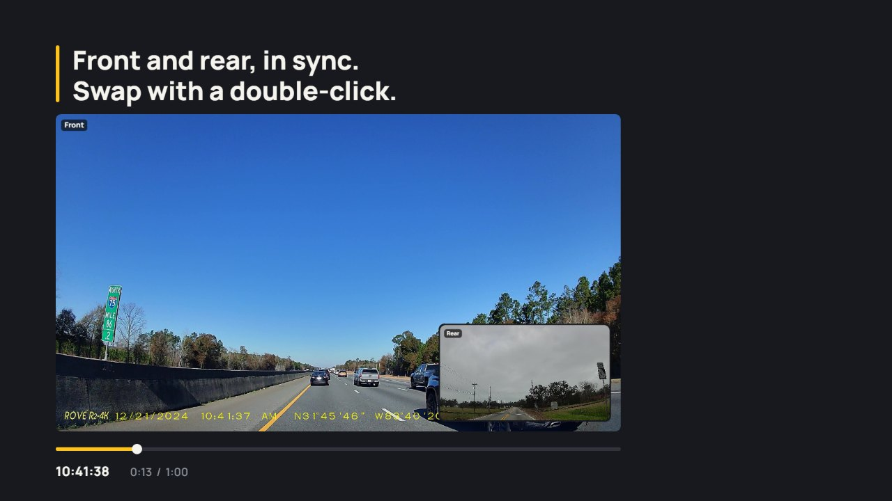

<p align="center">
  <a href="https://tripframe.vercel.app/">
    <picture>
      <source media="(prefers-color-scheme: dark)" srcset="public/brand/tripframe-horizontal-reversed.svg">
      <source media="(prefers-color-scheme: light)" srcset="public/brand/tripframe-horizontal-color.svg">
      
    </picture>
  </a>
</p>

<p align="center">
  <strong>Every drive, frame by frame.</strong><br>
  A free, open-source dashcam footage viewer that runs entirely in your browser.
</p>

<p align="center">
  <a href="https://tripframe.vercel.app/"></a>
  <a href="https://tripframe.vercel.app/app/"></a>
  <a href="LICENSE"></a>
  
</p>

<p align="center">
  <a href="https://tripframe.vercel.app/">
    
  </a>
</p>

Dashcams name every clip with a string of digits, like `2024_0315_143022_000123F.MP4`, and split each moment over separate front and rear files. **Tripframe** opens the SD card in your browser and turns that folder into a library: every clip by day and time, front and rear paired into one moment, ready to play, step through and save.

**Nothing is uploaded.** Files are read locally with the File System Access API. There is no server that receives your footage, no account and no tracking.

## Features

- **Timeline by day and time:** date, time, camera and recording type are read straight from the file names.
- **Front, rear and interior in one moment:** the cameras of the same second are paired, with a thumbnail of each.
- **Synced playback:** side by side, picture in picture or one camera. Swap front and rear with a button, the `W` key or a double-click. Drag the small picture's corner or the split line to resize.
- **Frame by frame:** step with `,` and `.`; the real clock time and frame number are shown.
- **Save a frame** as PNG, of one camera or all cameras side by side, named with the exact date and time.
- **Save a video of the view:** records what you see, picture in picture or side by side, with the map included when it is open.
- **GPS route on a map:** read from the video itself (Viofo/Novatek and BlackVue), with the speed alongside. Map by OpenStreetMap.
- **Filters** for camera and recording type (normal, event/locked, parking, photos), a day list that follows your scroll, and autoplay of the next clip.
- **Keyboard first:** press `?` in the player for every shortcut.
- **11 languages:** English, Nederlands, Deutsch, Français, Español, Italiano, Português, Polski, Русский, 한국어 and 日本語. Light and dark theme.
- **Works for ordinary folders too:** any folder of photos and videos (a phone export, an action camera, a drone card) is sorted by day and time.

## Supported dashcams

| Brand | Example file name | Read from the name |
| --- | --- | --- |
| Viofo and other Novatek-based cameras | `2024_0315_143022_000123F.MP4` | date, time, camera, parking/event |
| BlackVue | `20240315_143022_NF.mp4` | date, time, camera, normal/event/parking/manual |
| Thinkware | `REC_2024_03_15_14_30_22_F.MP4` | date, time, camera, recording type |
| 70mai | `NO20240315-143022-000123F.mp4` | date, time, camera, normal/event/parking |
| Nextbase | `240315_143022_001_FH.MP4` | date, time, camera |

Locked clips in folders such as `RO`, `Event` or `Protect` are marked as events, and `Parking` folders as parking. Other cameras work when the file name contains a date; otherwise the file's modification date is used. GPS is read from Viofo/Novatek `freeGPS` blocks and BlackVue NMEA data.

Is your camera missing or named differently? [Open an issue](https://github.com/JJanyar/tripframe/issues) with a few example file names.

## Use it

1. Take the microSD card out of the dashcam and put it in your computer.
2. Open **[tripframe.vercel.app/app](https://tripframe.vercel.app/app/)** and choose the card or its `DCIM` folder.
3. Pick a moment and play.

### Browser support

| Browser | Support |
| --- | --- |
| Chrome, Edge | Full: choose a folder, drag and drop, remembers the last folder |
| Firefox, Safari | Works through a folder picker |

Many dashcams record in **H.265 (HEVC)**. Edge plays it on most Windows PCs, Chrome needs the HEVC Video Extension from the Microsoft Store, and Safari on a Mac plays it out of the box.

### Keyboard shortcuts

| Key | Action |
| --- | --- |
| `Space` / `K` | Play or pause |
| `,` / `.` | One frame back or forward |
| `←` / `→` | 5 seconds back or forward (`Shift`: 1 second) |
| `↑` / `↓` | Previous or next clip |
| `W` | Swap front and rear |
| `1` / `2` / `3` | Side by side, picture in picture, one camera |
| `M` | Mute or unmute |
| `-` / `+` | Volume down or up |
| `G` | Show or hide the map |
| `S` | Save the current frame |
| `R` | Start or stop a video recording |
| `?` | Show the shortcuts |
| `Esc` | Back to the library |

## Privacy

Tripframe is a static web page. Your browser reads the folder you choose and nothing is sent anywhere: no uploads, no account, no analytics. It only reads files and never changes anything on the SD card. When a clip has GPS, the map tiles are loaded from OpenStreetMap.

## Development

Tripframe is plain JavaScript with [Vite](https://vite.dev/), [Leaflet](https://leafletjs.com/) for the map, [Motion](https://motion.dev/) for animation and [Lucide](https://lucide.dev/) icons. No framework, no backend.

```bash
git clone https://github.com/JJanyar/tripframe.git
cd tripframe
npm install
npm run dev
```

`npm run build` writes a static site to `dist/`. The build also writes a homepage per language (`/nl/`, `/de/` …) with the text in the HTML, a `sitemap.xml` and structured data, so search engines and AI assistants can read the pages without running JavaScript.

### Project layout

| Path | What it holds |
| --- | --- |
| `index.html`, `src/landing.*` | The homepage |
| `app/index.html`, `src/app.js` | The library: folder scan, filters, day list |
| `src/viewer.js`, `src/record.js` | The player, frame export and video recording |
| `src/parse.js` | File name parsing and front/rear pairing |
| `src/mp4.js` | Frame rate and embedded GPS from MP4 files |
| `src/locales/` | All interface text, one file per language |
| `seo.js` | Build step for static text, language pages and the sitemap |
| `public/brand/` | Logo and icons |

## Contributing

Contributions are welcome, especially support for more dashcam brands, translations and bug reports with example file names. See [CONTRIBUTING.md](CONTRIBUTING.md).

## Credits

Sample dashcam photos on the homepage are from Wikimedia Commons and are in the public domain or CC0. Flags from [flag-icons](https://github.com/lipis/flag-icons) (MIT). Map data © OpenStreetMap contributors.

## License

[MIT](LICENSE)
